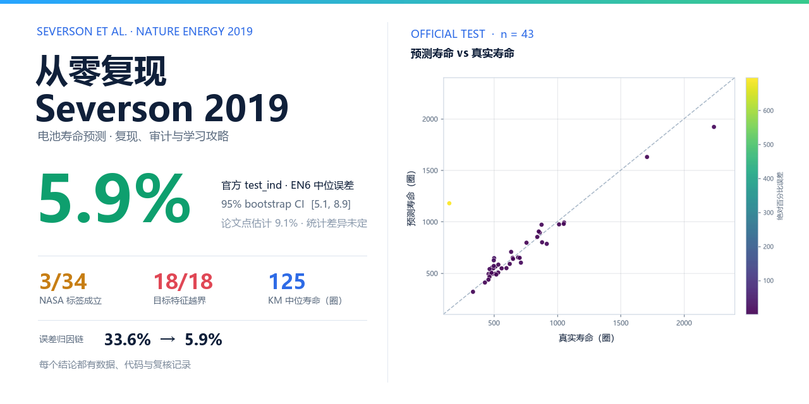

<div align="center">

# 从零复现 Severson 2019

**一份带"事故现场"的电池寿命预测学习攻略**


<p align="center">
  <a href="./README.md">English</a> · <b>简体中文</b>
</p>

</div>

---



> 用前 100 圈的数据预测电池还能活多少圈——Severson et al., *Nature Energy* 2019。
> 本仓库复现了这篇论文，并把复现路上的每一个 bug、每一次误判、每一条被数据打脸的预期，全部原样保留。

## 成绩单（先看结果）

在官方 `test_ind` 划分（n = 43）上，六特征弹性网络达到 **5.9% 中位百分比误差**（95% bootstrap CI 5.1–8.9），论文点估计为 9.1%。完整的误差归因链（**33.6% → 5.9%**）逐步记录在案。

| 模型 | 官方口径中位误差 | 均值 | batch3 外推 | 整批外推 |
|---|---|---|---|---|
| 弹性网络（六特征） | **5.9%** [CI 5.1~8.9] | 36.5%* | 4.9% | 28.7% |
| 随机森林 | 8.2% [4.6~12.2] | 13.9% | 9.4% | 32.4% |
| 论文原报告 | 9.1% | — | 未报告 | 未声称 |

\* 均值被少数夭折电池拉高；剔除寿命<500圈后均值 27.0%，预测截断敏感性结果 24.1%，见 docs/03。论文侧没有同口径 CI，故只称点估计接近，不宣称统计一致或优于。

### 超越复现的原创部分

- **数据集审计**：NASA 34 颗电池逐颗体检，证明寿命标签只对 **3/34** 成立——任何"直接迁移"都在用毒标签；
- **零样本迁移证据链**：MIT→NASA 迁移 EN 失控 ×75~125；按 MIT dev P05–P95 计算，NASA 三颗的 18/18 个电池×特征观测越界，明细见 `results/5_跨数据集迁移/MIT特征分位对照.csv`；
- **域间隙拆账**：四实验拆嫌疑——标签口径已排除（E2 ×202），窗口嫌疑已排除且反转（v2.1 重跑：真 3.6–3.8V 切片 E1 ×120→×246，匹配窗口反而更糟）→ 主犯=**协议级非平稳性**——"同样的早期指纹，不同的未来"；
- **KM 生存分析**：把 11 颗删失电池从"被丢弃"变成信息源，中位寿命 125 圈。

## 用途 / 你能用它做什么

六件具体的事，每件都有本仓库内可运行的入口（纯 CPU，教程路线完全不需要数据集）：

| 用途 | 真实入口（脚本/模块路径） |
|---|---|
| **零数据先把整条管线跑一遍**（玩具随机森林演示；合成 12 颗电池上的"地板效应"） | `python scripts/run_project.py --stage quick` · `scripts/toy_random_forest.py` |
| **在官方 `test_ind` 划分上复现论文**（六特征弹性网络 → 5.9% 中位误差） | `python scripts/run_project.py --stage paper` · `scripts/step4_3f_official_split.py` |
| **在采信任何公开电池数据集之前做审计**（NASA 34 颗逐颗体检；标签只对 3/34 成立） | `python scripts/run_project.py --stage extensions` · `scripts/step5a_parse_nasa_v4.py` |
| **量化跨数据集迁移并拆解域间隙**（MIT→NASA 零样本迁移失控 ×75~125；主犯=协议级非平稳性） | `scripts/step5b_zero_shot_v2.py` · `scripts/step5c_decompose_v2.py` |
| **用 Kaplan–Meier 生存分析把删失电池变成信息源** | `scripts/step5d_survival_v2.py` · `scripts/step5d_validate_km.py` |
| **运行并扩展 step6 优化实验**（主实验 / 迁移 / 生存分析） | `python scripts/run_project.py --stage optimization` · `scripts/step6a_main_optimization_v1.py`、`scripts/step6b_transfer_optimization_v1.py`、`scripts/step6c_survival_optimization_v1.py` |

Typical uses: (1) 当作 Severson 2019 的**可运行参照实现**，把自己那份复现拿来逐项对照；
(2) 当作**数据集审计清单**（[`docs/06_数据集审计方法论.md`](docs/06_数据集审计方法论.md)），在任何公开电池数据集上套用；
(3) 当作**电池数据课程的教学材料**——13 份中文文档，每个阶段都配动手练习；
(4) 当作**求职作品与面试准备路线**，含 30 问问答卡（[`docs/10_面试问答卡.md`](docs/10_面试问答卡.md)）。

本仓库的自检全部可离线完成：`python -m pytest tests -q` 在无数据集下跑 **6 个测试**，
`python scripts/run_project.py --stage quick` 跑无数据教学演示，
`python scripts/run_project.py --stage full --dry-run` 在完全不碰数据的情况下校验 full 路线全部 16 个脚本步骤。
复现类路线（`paper`、`extensions`、`optimization`）需要按 [`data/README.md`](data/README.md) 把 MIT-Stanford 与
NASA PCoE 数据集放到 `data/mit`、`data/nasa`；`full` 路线会重复解析约 8.3GB MIT 数据，只想复现论文时用 `paper`。
CI（workflow `tests`）目前只覆盖 Linux（`ubuntu-latest`）+ Python 3.14。

## 这份攻略的四种打开方式

| 你是谁 | 路线 | 入口 |
|---|---|---|
| **想学会这套方法** | 按阶段 1→5 跟做，每个阶段有直觉建立 + 动手练习 | [docs/00_怎么用这份攻略.md](docs/00_怎么用这份攻略.md) |
| **只想复现结果** | 环境 → 数据 → 跑 scripts/ 定稿脚本 | [docs/01_环境与数据_快速上手.md](docs/01_环境与数据_快速上手.md) |
| **从复现做个人求职作品** | 完成官方复现 → 设计自己的问题/数据 → 冻结评估口径 → 如实记录贡献 | [docs/11_实习求职包装指南.md](docs/11_实习求职包装指南.md) |
| **（HR/技术面试官）评估作者** | README → 03 复现篇 → 04 创新篇 → 10 问答卡 | 从本页往下读即可 |

## 仓库地图

```
├── README.md                  ← 你在这里
├── README.zh-CN.md            ← 中文版（本页）
├── CONTRIBUTING.md            ← 数据保护、实验口径与 AI/引用规范
├── .github/workflows/ci.yml   ← 无原始数据的自动测试
├── 项目一页报告.pdf            ★ 投递附件：成绩单+归因链+主图（单页）
├── docs/
│   ├── 00_怎么用这份攻略.md         学习路线图
│   ├── 01_环境与数据_快速上手.md    环境、数据下载、已知坑表
│   ├── 02_原理篇.md                每个概念为什么出现（含思考题）
│   ├── 03_复现篇.md                从模拟数据到 5.9% 的完整叙事
│   ├── 04_创新篇.md                审计/迁移/拆账/生存分析
│   ├── 05_调试实录.md              ★ 17 个编号现场（本攻略最独特部分）
│   ├── 06_数据集审计方法论.md      任何公开数据集套用前的 5 项检查
│   ├── 07_概念地图.md              一张图串起全部原理
│   ├── 08_常见错误FAQ.md           症状→根因速查表
│   ├── 09_读者练习.md              每阶段 2~3 道动手题
│   ├── 10_面试问答卡.md            30 问
│   ├── 11_实习求职包装指南.md      ★ 怎么完成项目/简历模板/面试话术/诚信边界
│   ├── 12_代码优化提案.md          优化实验菜单（约束/优先级/判读标准）
│   ├── buggy_注释版/               ★ 带事故注释的 bug 版代码（勿运行，教学用）
│   └── archive/                    原始工作日志、完整错误清单
├── scripts/                   定稿脚本 step1~5d；step6 为独立优化实验
├── figures/                   各阶段图库（目录名=阶段号）
├── results/                   全部数据表（CSV），含 optimization_v1 实验结果
└── data/README.md             数据集下载与放置说明
```

## 快速开始（三行版）

1. 装环境：Python 3.14，`python -m pip install -r requirements.txt`；无数据快速体验：`python scripts/run_project.py --stage quick`。
2. 完整复现前按 `data/README.md` 下载 MIT/NASA 数据；默认放在 `data/mit`、`data/nasa`。数据另存他处时复制 `config.example.toml` 为被忽略的 `config.toml`，再用 `--show-paths` 检查。
3. `python scripts/run_project.py --stage paper` 复现论文；`extensions` 跑 NASA 扩展，`optimization` 跑 step6，`full` 按全阶段顺序执行。`full` 为自包含教学脚本，会重复解析约 8.3GB MIT 数据；只想复现论文时用 `paper`。生成物位于 `results/generated/`，仓库内 `results/` 是已核验快照。

## 作者的话

这个项目里最有价值的不是 5.9%，而是那条误差归因链：**33.6% → 32.7% → 31.6% → 毒标签 → 5.9%**。每一步"错误→排除→再定位"都记录在 [docs/05_调试实录.md](docs/05_调试实录.md)——网上教程只给你正确的代码，这里把犯错的过程也给你。

> ilo · 新能源/材料方向在读本科生
> 双 AI 交叉审计工作流（独立管道互验 + 逐位一致性检查）

## 记录与复核材料

所有审查结论、修复时间线、NASA 34 颗全量复跑和发布边界统一见[项目审查与迭代记录](docs/项目审查与迭代记录.md)。三轮审查报告、任务书和前期工作记录的原始快照归档于 `docs/archive/审查原始记录/`；详细优化实验数字和执行过程见[代码优化提案执行记录](docs/工作记录_代码优化提案_2026-10-14.md)。

## 兄弟仓库：另一份独立复现

同一批数据（NASA PCoE + MIT-Stanford）、同一篇 Severson 2019，另有一份独立复现
**[锂电池 ECM-RUL](https://github.com/ilo-love7/battery-ecm-rul)**（仓库：`ilo-love7/battery-ecm-rul`），形态与本文互补：
本攻略是**学习路径**（step1→6 + 调试实录 + 面试卡），那份是**自洽的证据链**
（ECM 参数辨识、PyBaMM 物理仿真、第三方辨识审计、内阻真值标尺）。
两者有意保持为两个仓库，完整分工与口径对照见 [RELATED.md](RELATED.md)。

**两份复现的互证结论已于 2026-10-18 更新**（受控实验，详见 [RELATED.md](RELATED.md) 与
[docs/兄弟仓库互证与受控实验_2026-10-18.md](docs/兄弟仓库互证与受控实验_2026-10-18.md)）：

- **四条链的对齐改由逐颗直接核验证据支撑**（主测试 43 颗成员完全一致、寿命标签仅 3 颗续跑电池差 1 圈），
  不再依赖「RF 8.2% vs 8.12% 一致」——同口径有效对照（对方论文六特征 RF 9.38%）显示 RF 同样差约
  1.2 pp，与 EN 同向；此前的「完全一致」是不同特征集之间的巧合接近，不是四条链的证据。
- **ElasticNet 2.4 pp 差距的旧归因已被对方实验证伪并重新定位**：`l1_ratio` 只值 0.14 pp
  （同一份特征快照上固定 0.5 → 6.18%，网格搜索 → 6.04%）；差距主因是两条管线的论文六特征
  **数值定义差异**（对方旧配置换特征来源即从 6.18% 跳到 8.33%，误差结构完全不同）。
  本攻略的 5.9% 与对方存档值 8.33% 仍**不可互证，只可对照**。
- **显著性纪律与对方补测一致**：n=43 的 bootstrap CI 宽 5–9 个百分点，对方补测显示主测试上
  GBM（6.20%）与 EN（7.77%）差距并不显著（Wilcoxon p=0.93）——小样本下的模型排名多为描述性；
  本攻略「点估计接近论文 9.1%、不宣称统计一致或优于」的原有纪律与此互为印证。

对方可以从本攻略直接引用的三条结论：NASA 34 颗标签只对 3/34 成立、零样本迁移 ×75–125 误差膨胀、
域间隙拆账把主犯定位到协议级非平稳性。

## License & 数据致谢

- 代码：MIT License
- Severson, K.A. et al. *Data-driven prediction of battery cycle life before capacity degradation.* Nat. Energy 4, 383–391 (2019)
- 数据：MIT-Stanford 数据集（原论文官方）与 NASA PCoE 电池数据集，版权归原机构所有

## 关联仓库

本仓库属于同一作者在电池与交通建模方向的系列工作：

| 仓库 | 内容 |
|---|---|
| [battery-cathode-ml](https://github.com/ilo-love7/battery-cathode-ml) | 正极材料筛选：带隙 / 形成能 / 电压 / 容量 + 不确定度 + 多目标决策 |
| [battery-lifetime-guide](https://github.com/ilo-love7/battery-lifetime-guide) | 从零复现 Severson 2019 循环寿命预测（含翻车记录） |
| [battery-soh-tsfm-benchmark](https://github.com/ilo-love7/battery-soh-tsfm-benchmark) | 零样本时序基础模型 vs 线性外推：三数据集 SOH 基准 |
| [battery-ecm-rul](https://github.com/ilo-love7/battery-ecm-rul) | Thevenin ECM 参数辨识 + 早期寿命预测 + PyBaMM 仿真 |
| [drift-diffusion-pn-junction](https://github.com/ilo-love7/drift-diffusion-pn-junction) | 自研 1D 漂移–扩散–泊松求解器 + 三层验证 |
| [car-following](https://github.com/ilo-love7/car-following) | 跟驰建模工具包（7 模型 / 稳定性 / 标定 / 换道 / EV 能耗） |
| [project-packer](https://github.com/ilo-love7/project-packer) | 把真实项目包装成可防守的面试经历（事实档案 + 追问树） |
