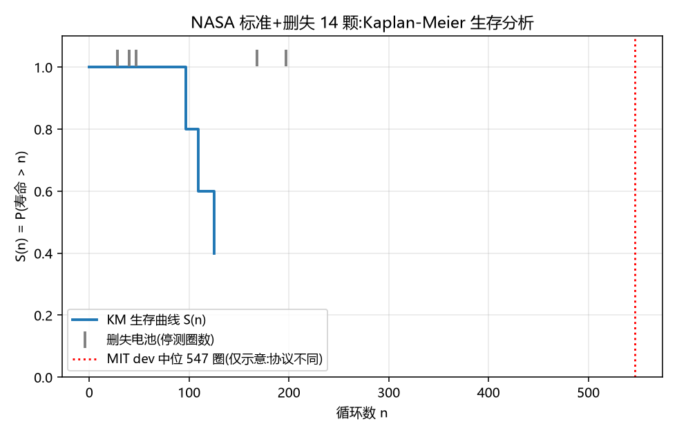
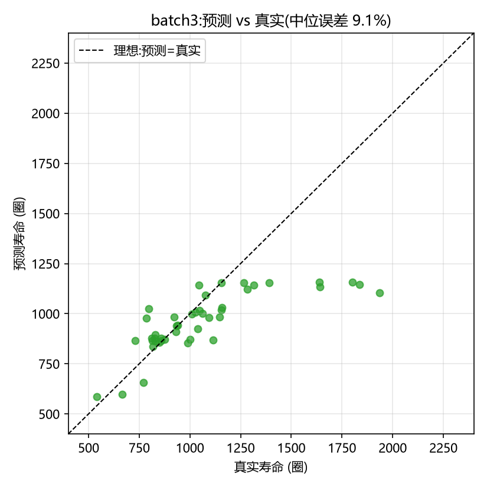
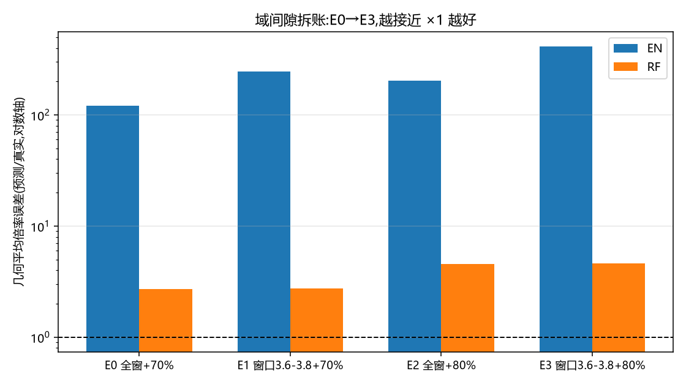
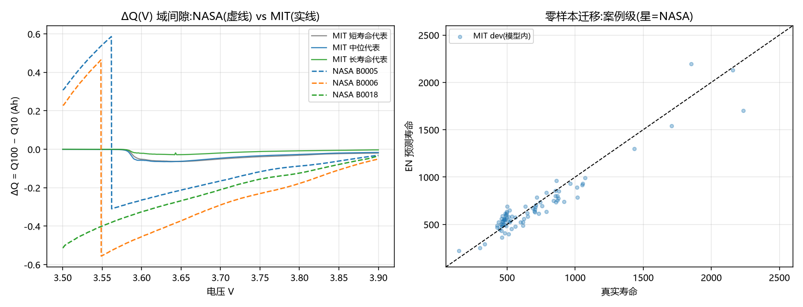

# 02 原理篇：每个概念为什么出现

> 排列顺序 = 项目中概念的出场顺序。每个概念回答三个问题：是什么 / 为什么需要它 / 在本项目哪里用到。含思考题（答案线索指向对应阶段）。

## 2.1 EOL（End of Life）与"寿命不是客观存在"

**是什么**：循环寿命 = 容量首次跌破阈值（本项目 MIT 0.88Ah=80%，NASA 1.4Ah=70%）的循环数。

**为什么**：电池没有"死亡时刻"，只有连续衰减。"寿命"= 物理行为 × 判定规则。规则一变，寿命就变（阶段 5c 的 E2 实验：只改 EOL 定义，误差倍率从 ×2.72 变 ×4.57）。

**思考题 1**：同一批电池，用 80% 和 70% 阈值算寿命，哪个排序可能变化？（提示：磨耗型 vs 拐点型，阶段 1 图）

## 2.2 磨耗型 vs 拐点型

**是什么**：两种衰减形态。磨耗型近似线性慢慢死；拐点型先缓后跳水暴毙（正极颗粒开裂等机理驱动）。

**为什么重要**：拐点型的寿命由拐点位置决定——而拐点在第 100 圈往往还没发生。**这正是本论文能成立的前提**：前 100 圈的细微指纹里藏着拐点的先兆。若所有电池都磨耗型，用早期斜率外推就够了，不需要机器学习。

## 2.3 删失（Censoring）与生存分析

**是什么**：测试没测到 EOL 就停了（测到 1.42Ah 差 0.02 没过线，或只测了 40 圈）——这颗电池"还活着"，但**不知道真实寿命**。

**为什么重要**：直接把删失电池扔掉 = 测试越久的数据越保留 = 系统性偏差；把它们当正常样本 = "B0007 寿命 168"这种错误标签（它只是还没死）。正确姿势是**生存分析**：删失点告诉模型"至少活到这"。

**本项目用法**：阶段 5d 用 Kaplan-Meier 处理 3 个事件 + 11 个删失，中位寿命 125 圈。注意 CI 极宽——删失多事件少时，KM 给量级不給精度。

**思考题 2**：9 颗删失全在第 47 圈前退出，3 个死亡集中在 97~125 圈——为什么 KM 中位数反而"可估"？（答案在 docs/04 §5d）

## 2.4 三种老化指纹与 dQ/dV

**是什么**：容量-电压曲线的微分（dQ/dV）把"缓坡"变成"峰"，峰的位置和高度对应三种老化：LLI（锂库存损失，峰整体移动）、LAM（活性材料损失，特定峰变矮）、阻抗上升（峰变宽）。

**为什么重要**：单点容量值几乎不含机理信息（阶段 4.1 实测：第 100 圈容量与寿命几乎不相关）；曲线**形状**才携带"怎么老化"的信息。

## 2.5 ΔQ(V) 六特征

**是什么**：ΔQ(V) = Q_100(V) − Q_10(V)（第 100 圈与第 10 圈的放电曲线相减），从这条差曲线上提取六个数：

| 特征 | 数学 | 物理直觉 |
|---|---|---|
| log_var | log(Var(ΔQ)) | 曲线整体起伏=老化幅度（论文最强特征，与寿命负相关） |
| log_min | log(min(ΔQ)) | 曲线最低谷 |
| log_mean | log(mean(ΔQ)) | 整体偏移 |
| slope/intercept/discrepancy | 容量序列前 100 圈线性拟合 | 宏观衰减速度（注意：这仨来自容量序列，不是 ΔQ 曲线） |

**关键点**：六特征是"形状特征（3）+ 趋势特征（3）"的组合。阶段 4.2 实测：模型给电压类特征合计重要性 0.92——它自己学出了"形状 >> 容量"，与论文立论一致。

**思考题 3**：为什么 log_var 要取对数？（提示：方差跨电池差几个数量级，线性回归在 log 空间外推，见 2.6）

## 2.6 地板效应与"模型选择 = 分布匹配"

**是什么**：RF 用"叶子邻居的平均"做预测，**永远给不出训练分布之外的值**。测试集真实寿命低于训练分布下限时，预测被地板卡住。

**本项目实证**：4.3a，5 颗夭折电池（148~335 圈）全被预测成 ~577 圈（训练集下限附近）；而弹性网络在 log 空间是线性外推，能"想多低给多低"——同一次对比里 EN 赢中位、RF 赢均值（EN 极端点会失控到 ×125，RF 有界但系统性偏高，见 5b）。

**推论**：论文选弹性网络不是"它最好"，是**测试分布的结构决定的**。换一道题（整批外推、跨数据集），"最好"的模型就换了。

**思考题 4**：整批外推场景（batch1→batch2）里 EN 28.7% vs RF 32.4%——为什么分布外场景反而是线性模型赢？（提示：测试集在训练分布的哪个方向）

## 2.7 不确定性量化：bootstrap CI

**是什么**：对官方测试集 43 颗电池的逐颗误差有放回重抽样 10000 次，每次重算中位误差，得到误差分布 → CI。本项目：EN6 中位 5.9% [CI 5.1~8.9]。

**为什么重要**：本复现报 5.9% [5.1~8.9]，论文报告点估计 9.1%；两者同属个位数误差，但相差 3.2pp。我们的 CI 上沿距论文点估计 0.2pp，**论文侧没有同口径 CI 或逐颗误差可用于联合比较**，因此不能判断统计差异，也不声称优于论文；准确表述是"点估计接近，统计可比性未定"。

**附加发现**：剔除寿命 <500 圈电池后，EN 中位/均值为 6.1%/27.0%；另做预测截断敏感性分析后，均值由 36.5% 降至 24.1%。两者是不同分析，不能把 24.1% 写成"剔夭折后均值"；**截断不是免费午餐**，敏感性分析应与主结果分开报告。

## 2.8 协议级非平稳性（本项目的原创贡献）

**是什么**：同样的早期电压指纹，在不同测试协议（充放电倍率、电压窗口、随机化工况）下指向完全不同的未来。

**怎么定罪的**（阶段 5c 四实验，几何平均倍率误差）：

| 实验 | EN | RF | 排除假设 |
|---|---|---|---|
| E0 基线（全窗+70%EOL） | ×120 | ×2.72 | — |
| E1 电压窗口匹配 3.6-3.8V | ×246 | ×2.75 | 窗口伪影（真窗口切片误差反而翻倍） |
| E2 标签匹配 EOL@1.6Ah | ×202 | ×4.57 | 标签口径（预测不变、真实寿命变短、倍率反放大） |
| E3 双匹配 | ×413 | ×4.62 | 剩余=体系/倍率本征差异 |

> **v2.1 勘误（已重跑更新）**：E1/E3 的切片曾误用 `arange(100,900)` ≈ 3.54–3.86V，NASA ~3.55V 极拐点伪影仍在窗内。v2.1 按电压值取真 3.6–3.8V 后重跑，上表已更新：E1 ×105→**×246**、E3 ×177→**×413**（RF：×2.72→×2.75、×4.58→×4.62）；E0/E2 数字逐颗一致、不受影响。

每个假设都被设计成"如果它是主犯，修正它误差应当大跌"的可证伪实验——E2 跌不动（标签口径无罪）已坐实；E1 换真 3.6-3.8V 窗口后误差不降反升（×120→×246）：匹配窗口救不了迁移，反而切掉了低电压段的判别信息，窗口伪影排除且反转，主犯坐实为协议本身。

**一句话**：**同样的早期指纹，不同的未来。** 5b 的 MIT/NASA 分位对照中，NASA 三颗的 18/18 个电池×特征观测落在 MIT dev 的 P05–P95 范围之外；EN 预测倍率 ×75~125。逐项数值见 `results/5_跨数据集迁移/MIT特征分位对照.csv`。

## 2.9 零样本迁移与域间隙

**是什么**：零样本 = 源域训练、目标域直接预测（不微调）。域间隙 = 源/目标联合分布的差异。

**本项目证据链**：特征层（分位表：NASA 特征 5/6 处于 MIT 的 P0/P100）→ 预测层（×75~125）→ 归因层（5c 四实验）。**逐层递进、每层都有数字**，这比一句"分布不一样所以迁移失败"可信一个数量级。

**思考题 5**：RF 迁移只错 ×2.2~3.1 而 EN 错 ×125——结合 2.6 的"有界的错"，预测哪个模型更适合做迁移的"保险丝"？
