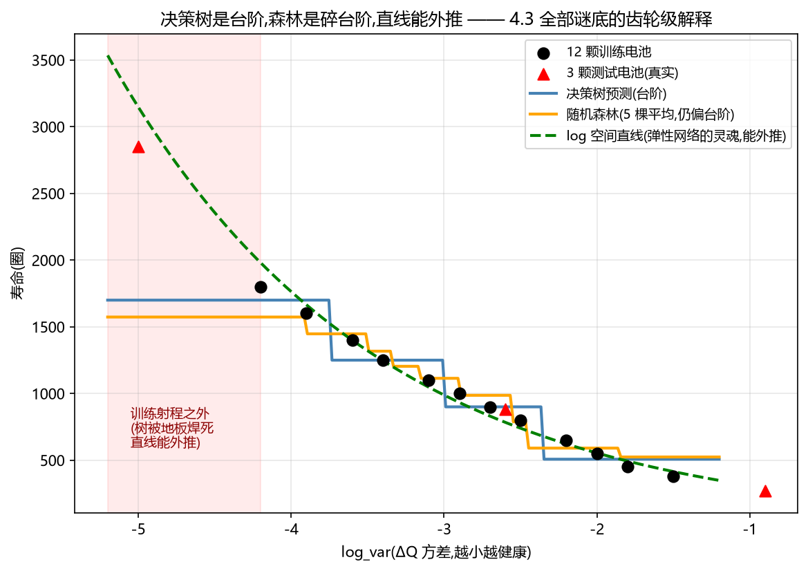
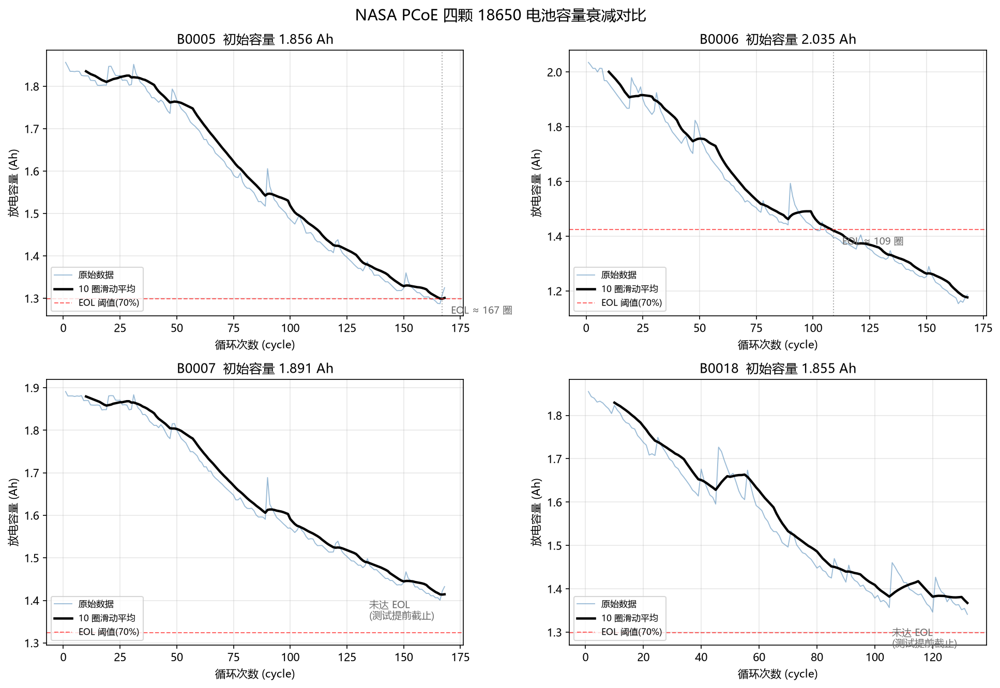
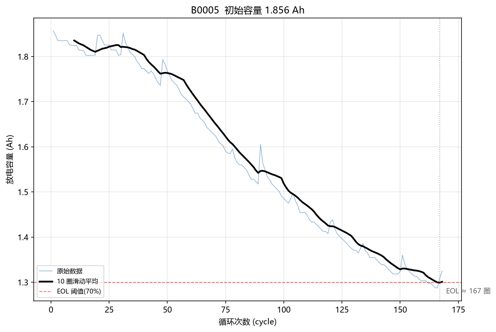
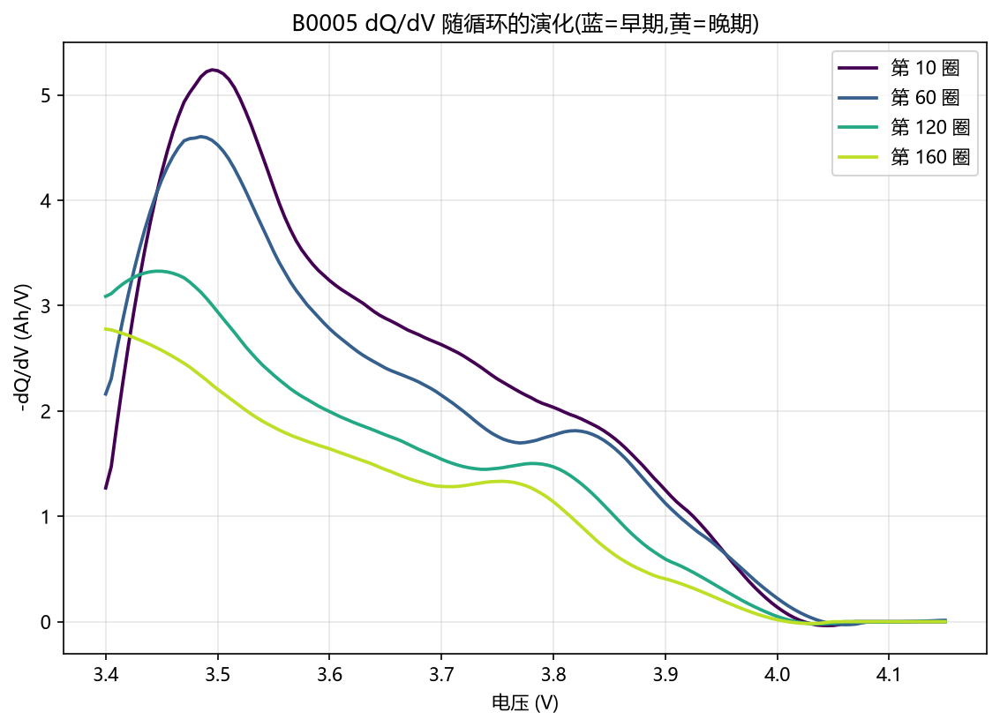
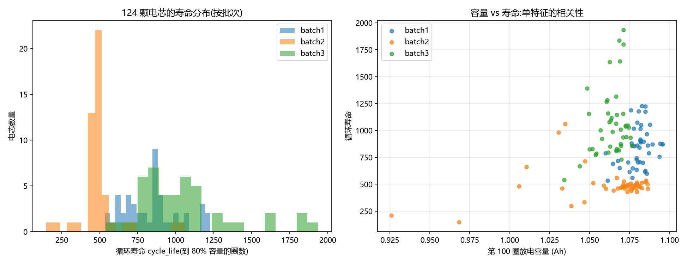
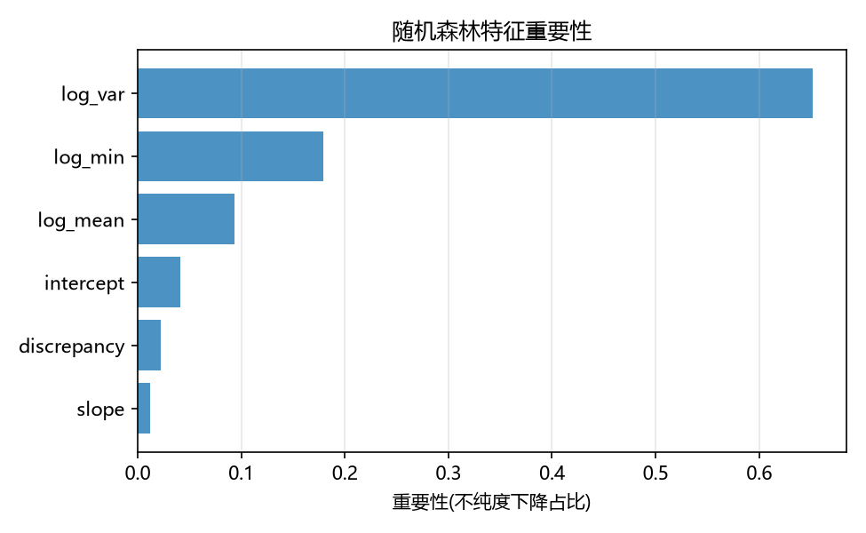
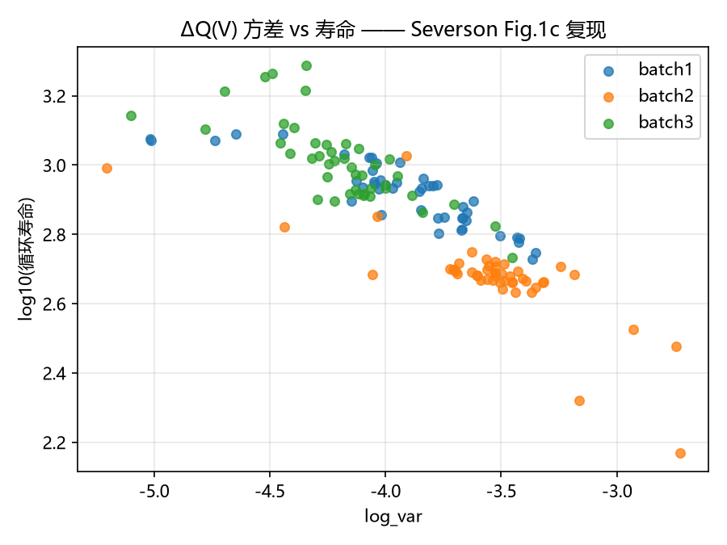
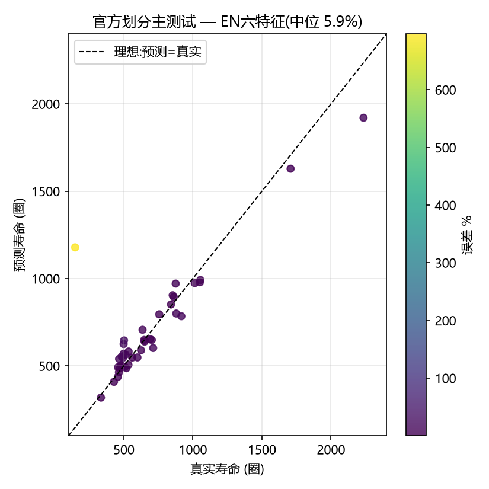
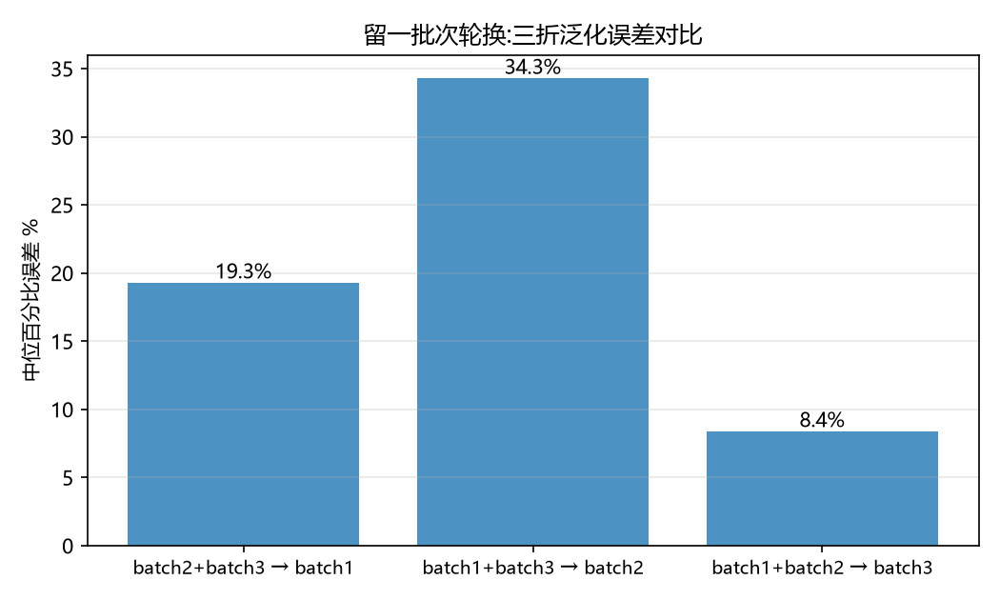

# 03 复现篇：阶段 1~4，从模拟数据到 5.9%

> 叙事版复现记录。原始逐日日志见 docs/archive/项目全程记录_原始日志.md。

## 阶段 1：模拟数据入门（toy_random_forest.py）

**目的**：在碰真实数据前，用一台"容量衰减模拟器"建立三个直觉：EOL 怎么定义、磨耗型与拐点型的差别、"寿命"是规则与物理的乘积。

**做了什么**：生成两条衰减轨迹（线性磨耗 / 带拐点暴毙），分别按不同阈值判 EOL，直观看到"同一个电池，规则变了寿命就变"。

**带走的东西**：寿命标签不是测出来的，是**定义出来的**——这个意识在 5c（改 EOL 定义误差倍率从 ×2.72 变 ×4.57）兑现了价值。

## 阶段 2：NASA 4 颗真实数据（step1~step3）

**目的**：用 B0005~B0007、B0018 四颗小数据把"脏数据清洗 → 平滑 → 判 EOL → 删失"全流程走通，每颗电池体量小、肉眼可查。

**关键动作**：
- 容量序列的**回弹/噪声**处理（移动平滑），否则假回升会被当成"电池复活"；
- EOL@1.4Ah 判定：B0005 实际 ~125 圈（注意不是常被引用的 168——那是测到 1.32Ah 的总放电数，见 docs/05 案例 15）；
- B0007/B0018 属于"测了但没测到死"→ **删失**概念的活教材。

**带走的东西**：真实数据第一课——**先体检后建模**。这个习惯在阶段 5 放大到 34 颗规模。

## 阶段 3：dQ/dV 老化指纹（step3）

**目的**：看懂"容量值没用、曲线形状才有信息"。

**做了什么**：计算放电 dQ/dV 曲线，对比不同健康度下的峰位移/峰变矮/峰变宽，对应 LLI / LAM / 阻抗上升三种老化。

**带走的东西**：ΔQ(V) 特征思想的原理基础——第 4 阶段的六特征就是"把两条放电曲线相减，从差曲线提六个数"。

## 阶段 4.1：MIT 数据集解析（step4_mit_load.py）

**数据**：官方 124 颗（3 个 .mat，HDF5 格式，8.3GB）。138 颗为含官方剔除数的原始总数。

**关键动作**：
- HDF5 逐层解引用 + MATLAB 1-based 偏移的探针验证（不猜布局，先探后解）；
- 解析缓存 `mit_parse_cache.pkl`——首跑 5~10 min，之后秒开；
- 解析完产出 `mit_cells_table.csv`（138 颗原始总表，含官方剔除项；官方规则筛选后为 124 颗）。

**意外发现**：**第 100 圈容量与循环寿命几乎不相关**——"电池现在还剩多少电"回答不了"电池还能活多久"，为阶段 4.2 的形状特征铺垫。

## 阶段 4.2：六特征移植（step4_2_mit_features.py）

**关键动作**：对 138 颗原始记录计算 ΔQ(V) 六特征（3 形状 + 3 趋势），官方筛选后 124 颗进入主模型，随机森林验证：
- `log_var` 与寿命**负相关**（幅度越大死得越早）——定性复现论文核心图；
- 特征重要性：**电压类合计 0.92**——模型自己学出了"形状 >> 容量"。

**环境坑**：sklearn 新版删 `n_alphas` 参数 → 最小参数集重写（docs/05 案例 12）。

## 阶段 4.3：误差归因链 33.6% → 5.9%（四轮）

这是整个复现的核心故事，完整版在 docs/05。这里给主干：

| 轮次 | 脚本 | 中位误差 | 结论 |
|---|---|---|---|
| 4.3a 首跑 | step4_3_rf_predict.py | **33.6%** | 5 颗夭折电池全被 RF"地板"卡在 ~577 → 发现地板效应 + 夭折电池事件 |
| 4.3b 过拟合排查 | step4_3b_model_compare.py | 32.7% | 三模型对比排除"模型选错"假设 |
| 4.3c 考卷对齐 | step4_3c_official_filter.py | 31.6% | 官方剔除对齐后几乎没变 → 问题不在剔除口径 |
| 4.3d~f 毒标签修复 | step4_3f_official_split.py | **5.9%** | 0 占位符 bug（标签=1 圈）+ iterrows 副本（诊断✓下游错）双双修复 |

**定稿数字**（官方 test_ind 混合划分）：

| 模型 | 中位误差 [bootstrap CI] | 均值 |
|---|---|---|
| EN6（六特征） | **5.9% [5.1~8.9]** | 36.5%（剔除寿命<500圈后 27.0%；预测截断后 24.1） |
| RF | 8.2% [4.6~12.2] | 13.9% |
| 论文 | 9.1% | — |

RF 的 43 颗逐颗预测/误差表：`results/阶段43f_论文主测试_RF逐颗误差.csv`。

**措辞定稿**：本复现中位数 5.9% [5.1~8.9]，论文点估计 9.1%；论文侧缺少同口径 CI/逐颗误差，不能判断统计差异。应称"点估计接近，统计可比性未定"，不称统计一致或优于。bootstrap 10000 次，`results/阶段43f_三口径汇总.csv`。

**另一条线**：与另一个 AI 的独立管道逐位一致（交叉验证）——独立的代码路径得到相同的数字，比单管道自检可信一个数量级。

**整批外推**（独立结论，不与论文对标）：batch1→batch2 整批 EN 28.7% / RF 32.4%——论文从没声称能整批外推，这个数字回答的是"部署难度"。

**整批外推的误差结构（地板效应约占 1/3）**：batch2 的 43 颗里有 40 颗寿命低于训练池下界（534 圈），树模型无法外推到射程之外，只能把预测压在边界附近。以 `(534−真实)/真实` 计"地板误差"，其中位数 11.5%——RF 短命组 32.6% 的误差里约 1/3 是这个机制的**必然代价**（叶子只能输出训练样本的均值），剩下约 2/3 才是模型可改进的空间。这也是"先拆误差结构、再谈模型优劣"的实例：同一个 32.4%，拆开之后一大半并不归模型。

**口径B 的已知限制（已复核）**：v1 中 RF 的超参是在混合池（含 batch2）上网格搜索后复用到 batch1-only 训练的，对"batch2 即考卷"的口径B 属于轻微超参泄漏。v1.1 已改为在 batch1 内独立网格搜索重选超参并重跑：RF 32.2%→**32.4%**（均值 39.1% 不变），泄漏影响可忽略，结论不变（EN 本就不受影响，28.7%）。
