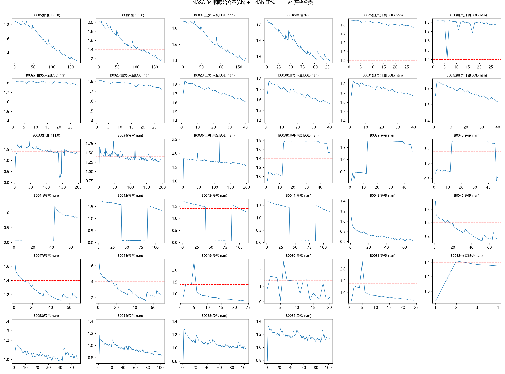
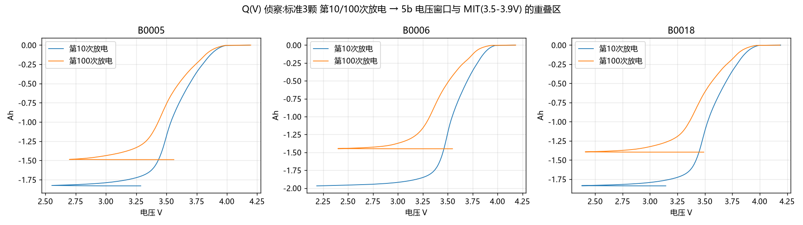

# 04 创新篇：阶段 5，在论文停下的地方往前走

> 论文只回答了"MIT 数据上 9.1%"。阶段 5 追问四个论文没回答的问题：换一个数据集标签还成立吗？模型能直接搬过去吗？搬不过去到底差在哪？删失电池的信息怎么用？
> 全部产出：figures/5_跨数据集迁移/ + results/5_跨数据集迁移/（四张表）。

## 5a 数据集审计：NASA 34 颗只有 3 颗标签可用

**动机**：直接把论文管线搬到 NASA——第一反应是"再验证一次"。正确反应是：**先审计标签再训练**。

**方法**（step5a_parse_nasa_v4.py）：对 34 颗逐颗体检，四道分类门：
1. **尖峰门**：单圈容量跳变过大（解析伪影）；
2. **中断井门**：容量 <1.0Ah 占比 >10%（测试中断井：跌到 0.1 再跳回，B0042/43/44）；
3. **抖动门**：相邻圈差分中位 >0.06（随机化工况，B0033 起）；
4. **从未满充门**：p95 <1.6Ah（协议就没充满过，EOL 概念失效）。

**结果**：标准（标签成立）**3 颗**（B0005/06/18）；**删失 11 颗**；中断井 11 颗；从未满充 7 颗；样本过少 1 颗；边界（B0033，5d 决议不入迁移/KM）1 颗——合计 34。表：`results/5_跨数据集迁移/NASA34颗体检分类.csv`。

**全量复跑**：2026-10-15 使用配置中的完整 NASA 34 个原始 `.mat` 重新运行 extensions 路线；逐颗分类数与上表一致，KM 输出表与核验快照逐行相同。新生成审计表/图保存在本机 `results/generated/`（被 Git 忽略）；仓库中的 `results/5_跨数据集迁移/` 保留可公开的核验快照。

**为什么重要**：如果跳过审计直接迁移，11 颗井电池的"寿命"实为井深（如 B0042 的 42）会直接进训练集——4.3d 的毒标签事故会原样重演，而且这次没人盯着诊断打印。

## 5b 零样本迁移：×75~125 的惨案与证据链

**方法**（step5b_zero_shot_v2.py）：MIT 训练（84 颗，dev 断言锁定）→ NASA 3 颗真标准电池直接预测。

**结果**（三层证据，每层有数字）：
- **预测层**：EN 预测 / 真实 = **×75~125**；RF ×2.2~3.1（有界的错）；
- **特征层**：MIT dev 的 P05–P95 对照显示，NASA 三颗的 18/18 个“电池×特征”观测均在该范围外；逐项数值见 `results/5_跨数据集迁移/MIT特征分位对照.csv`；
- **案例层**：`results/5_跨数据集迁移/零样本预测案例.csv` 逐颗明细。

**样本限制**：标准目标电池只有 3 颗；迁移倍率对特征提取与模型实现敏感，所有结论仅描述这三个案例，不能外推成总体性能保证。step5b 和 step5c E0 来自不同脚本/特征提取流程，不应把两套逐颗倍率当作同一个估计直接比较；后续 step6 的 z-score/CORAL 和 few-shot 结果也维持探索性定位。

**解读**：RF 的错有界（地板效应的另一面），EN 在分布外会想多离谱给多离谱——**预测误差的"形状"本身就是域间隙的证据**。

## 5c 域间隙拆账：四实验定罪协议级非平稳性

**方法**（step5c_decompose_v2.py）：把"迁移失败"拆成嫌疑人，逐个设计可证伪实验——若某假设是主犯，修正它后误差应大跌：

| 实验 | 改了什么 | EN 倍率 | RF 倍率 | 判决 |
|---|---|---|---|---|
| E0 基线 | 全窗 + EOL@1.4Ah | ×120 | ×2.72 | — |
| E1 | 电压窗口匹配 3.6-3.8V | ×246 | ×2.75 | 窗口伪影否决（真窗口切片误差翻倍） |
| E2 | 标签匹配 EOL@1.6Ah | ×202 | ×4.57 | 标签口径无罪（且反向放大） |
| E3 | 双匹配 | ×413 | ×4.62 | 剩余=体系/倍率本征差异 |

> **v2.1 勘误（已重跑更新）**：E1/E3 的切片曾误用 `arange(100,900)` ≈ 3.54–3.86V，NASA ~3.55V 极拐点伪影仍在窗内——旧窗口数字（E1 ×105/×2.72、E3 ×177/×4.58）已由 step5c v2.1 按电压值取真 3.6–3.8V 重跑替换为上表数字（E1 ×246/×2.75、E3 ×413/×4.62）；E0/E2 逐颗一致、不受影响。

**结论**：标签口径嫌疑已排除（E2 跌不动且反向放大）；窗口嫌疑同样排除且反转（v2.1 重跑 E1：×120→×246，匹配窗口不救反而切掉低电压段判别信息）。三案齐否 → 定罪**协议级非平稳性**——NASA 的倍率与随机化工况让"同样的早期指纹"指向不同的未来。表：`results/5_跨数据集迁移/域间隙拆账_四实验.csv`。

**方法论价值**：这不是"跑个实验看看"，是**几何平均倍率口径下的假设排除**——每个实验都能被证伪，结论"主犯是协议本身"是排除法的产物。

## 5d KM 生存分析：把删失电池从"废料"变成信息

**动机**：34 颗里 11 颗删失（没测到死）。扔掉=偏差，当真=毒标签。第三条路：生存分析。

**方法**（step5d_survival_v2.py）：Kaplan-Meier，时间=循环数，事件=过 EOL@1.4Ah。

**结果**（`results/5_跨数据集迁移/KM生存表.csv`）：
- S(97)=0.8 → S(109)=0.6 → **S(125)=0.4，中位寿命 125 圈**；
- 可估寿命电池全部 ≤125 圈 vs MIT 中位 547 圈（4.4~5.6 倍差距），与 5c 判决自洽；
- 删失刻度聚在 0~50 与 168~197 两段 = 两个测试批次的历史痕迹；
- B0036（197 圈未到 EOL）为全舰队最强——未来 NASA 内部标定实验首选。

**诚实声明**：14 颗入组、仅 3 事件，CI 极宽——**125 只保量级**。但对比"扔掉 11 颗"，这份结论的信息量是净增加。

## 阶段 5 小结：原创部分的贡献清单

1. **审计协议**：34 颗逐颗体检 + 四道门 → 可复用的数据集质检流程（推广版见 docs/06）；
2. **证据链范式**：特征层 → 预测层 → 归因层，每层有数字，拒绝"感觉不一样"；
3. **假设排除法**：四个可证伪实验 + 几何平均倍率 → 定罪协议非平稳性（标签项已坐实；窗口项 v2.1 重跑后排除且反转）；
4. **删失利用**：KM 把 11 颗删失电池变成中位数估计的信息源。
