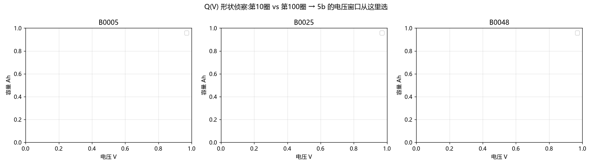
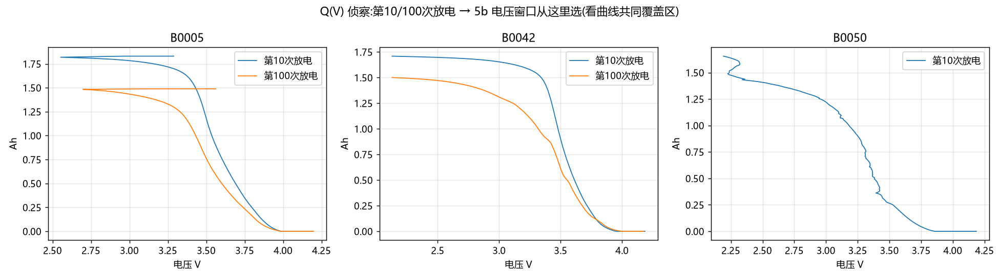
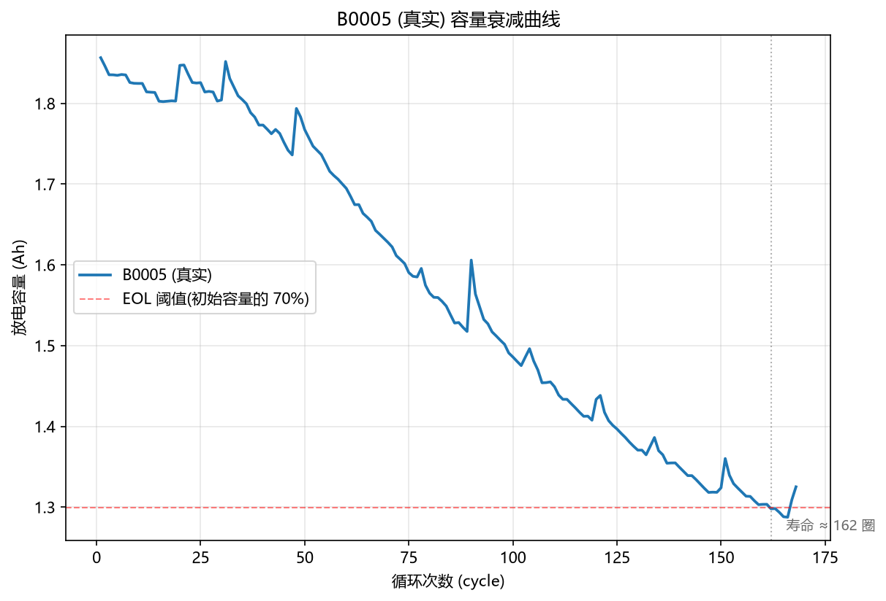

# 05 调试实录（Debug Diary）

> 本文档记录 17 个编号现场，均来自本项目真实错误或协作事故，按"现象 → 当时反应 → 根因 → 修复 → 教训"整理。
> 配套：`docs/buggy_注释版/` 里的 4 个脚本保留了 4 个典型 bug 的原始现场；完整表格版见 `docs/archive/项目错误清单.md`。

---

## 第一部分：代码与工程问题（案例 1–14）

### 案例 1：CV 指标 0.135——"带毒结果差点过审" ★★★

**现场**：4.3d 续跑合并，把 batch2 文件里 5 颗电池的后段拼回 batch1 前 5 颗。合并完成，跑弹性网络，中位误差 10.8%——"复现达成！"差点直接写进报告。

**现象**：结果"不错"，但两个细节不对劲：CV MAE 异常跳到 0.135（此前 0.03 量级）；合并诊断打印出 `batch1#0: 1190 → 1`。

**当时反应**：结果好看，差点忽略打印里的刺眼数字。被翻出合并明细当场拆穿：5 颗标签全变成了"1 圈"。

**根因**：重算寿命从第 1 圈扫起，但 MIT 数据每颗电芯**第 1 圈 QDischarge 是 0 Ah 占位值**。占位值必然低于 EOL 阈值 0.88Ah →"第 1 圈就死了"→ 标签=1。写特征时跳过了 index 0，写标签时忘了——同一个数据，两处代码，一处记得一处忘。

**修复**：robust_life（跳过开头占位圈 + 连续 3 圈低于阈值才判 EOL，防单圈假跌）+ 生效断言：合并后标签不等于 [1851, 2159, 2236, 1433, 1708] 就直接 raise。

**教训**：**CV/验证指标异常 = 数据在报警，先看明细再报喜。** 结果变好不可信，结果变好+诊断数字变怪更不可信。

---

### 案例 2：诊断打印全 ✓，下游全错——pandas iterrows 副本陷阱 ★★★

**现场**：4.3e 修复标签合并。代码先建查找表再逐颗改标签，诊断打印每一项都对。

**现象**：打印全绿，但下游训练用的还是旧标签（batch1#0 标签 1190≠1851）；更离谱的是测试集出现预测 12740 圈的极端值。

**当时反应**："打印都对了为什么没用？！"——这类 bug 的标准体验：每一层看起来都对，整体却是错的。

**根因**：`iterrows()` 返回的是 **Series 副本**。查找表存了副本，"改标签"改在副本上，`feat_df` 本体纹丝没动。诊断打印恰好读的也是查找表——**看的是同一份假数据，当然全 ✓**。

**修复**：查找表存行索引，写回用 `feat_df.at[idx, "cycle_life"]`；再加合并生效断言（见案例 1）。这个陷阱后来在 4.3f 又复发一次（第三次应验"复用代码必须逐字拷贝"）。

**教训**：pandas 里 iterrows 行"读"可以，"写"必炸；查表存索引不存对象。**诊断打印和被诊断的数据不能同源**——同源的 ✓ 是自我循环论证。

> 彩蛋：另一协作者（另一个 AI）的独立版本同样用 iterrows 建查找表，但写回用了 `feat_df.loc[mask, ...]` 掩码——侥幸正确。同一坑，两种踩法，见 `docs/buggy_注释版/step4_3d_merge_continued.py` 头部注释。

---

### 案例 3：考卷拿错——方法论错误贵过代码错误 ★★★

**现场**：4.3 系列对齐官方后仍 31.6%，怎么调都不动，一度怀疑论文数字有问题。

**现象**：我们一直拿 batch1→batch2 **整批外推**对标论文的 9.1%。

**当时反应**：死磕模型和特征，方向完全错了。

**根因**：查证官方 `LoadData.m` 才发现，论文 9.1% 用的是 **test_ind 混合划分**（batch1+batch2 共 84 颗按索引抽出 43 颗测试），整批外推是另一道题。论文根本没声称自己能整批外推——拿错的考卷批改卷子。

**修复**：按官方划分重跑 → 5.9%，一次到位。整批外推（28.7%）作为独立结论保留——它回答的是"部署难度"这另一个问题。

**教训**：**对标任何数字前，先确认口径。** "复现不了"有三个可能：代码错了、数据错了、**考卷拿错了**——第三种最贵，因为它浪费的是前面所有的调试。

---

### 案例 4：GBK 撞 UTF-8——中文 Windows 的专属礼物

**现场**：4.3f 首跑，Windows 11 中文版。

**现象**：`UnicodeDecodeError: 'gbk' codec can't decode byte 0x94`——报错指向 sklearn 内部。

**当时反应**：我的代码一行中文都没有，为什么 GBK？

**根因**：Jupyter 显示 sklearn estimator 的富 HTML 时，`_repr_html_` 去读 estimator.js 未指定编码，Windows 默认 GBK，撞上文件里的 UTF-8 字节。

**修复**：`sklearn.set_config(display="text")`；顺手立了条规矩：`.fit()` 单独成行，不留格尾表达式（格尾会触发 repr → 触发富显示）。

**教训**：报错栈指向库内部 ≠ 你的代码没错，但更 ≠ 库错了；先搜"报错+你的系统语言"。

---

### 案例 5："卡住了"——不是 bug 的 bug

**现象**：解析 8.3GB .mat 时脚本静默数分钟。像死机。重跑 → 还是静默 → 再重跑，最后机器越来越慢。

**当时反应**：怀疑代码死循环。

**根因**：两层：①解析 8.3GB 本来就要几分钟，没有任何进度输出，静默≠卡死；②多次重跑导致 Jupyter 内核堆积，内存被吃光。

**修复**：解析加 pickle 缓存（`mit_parse_cache.pkl`，首跑慢后续秒开）+ 每 10 颗打印进度（`flush=True`，否则 print 也被缓冲）；重跑前先杀干净 python.exe、Restart Kernel。

**教训**：**长时间运行必须带进度输出和缓存**——"静默的辛苦"会被用户当成"死机"，然后被杀死重跑，然后真死机。这不是代码问题，是人机接口问题。

---

### 案例 6：`KeyError: no field of name 'cycles'`——猜字段名的代价

**现场**：阶段 5 解析 NASA 数据集。

**根因**：凭文档印象预设字段名 `cycles`，实际官方字段是单数 `cycle`。

**修复**：不猜了——写 `cycles_container()` 动态探测：打印实际字段清单、剥离外壳再取数。

**教训**：**不猜字段名、不猜布局、不猜协议，先探针后解析。** 报错信息的 `no field of name 'cycles'` 已经把正确写法暗示给你了（单数），读报错要逐字。

---

### 案例 7：三张全空的白图——数组语义错了

**现象**：5a v2 的 Q(V) 侦察图三格全空白，无报错。

**当时反应**：图床代码抄的上一个脚本的，为什么没图？

**根因**：取数用"容器里第 10/100 个条目"。但一个 cycle 容器混装 616 个条目（charge/discharge/impedance），第 10 个多半不是放电——取到的是空数组，画空图不报错。

**修复**：改按"第 N 次**放电**"计数。

**教训**：**画图全空白比报错更危险**——报错逼你修，空白图你可能顺手跳过。任何"取数组第 N 个"都要先问：N 的单位是什么？

---

### 案例 8：误报 5 颗"标准电池"——分类门的进化史

**现象**：5a v3 把 B0042/43/44 标为"标准，寿命 42"——但这些电池测试中途容量跌到 0.1 Ah 再跳回（测试中断井），"寿命 42"是井的深度，不是寿命。

**当时反应**：为什么守卫拦不住？查 v3 门控——只有"p95<1.6"一道从未满充门。

**根因**：v3 缺两道门：①中断井门（容量<1.0Ah 占比>10%）；②抖动门（相邻圈差分中位>0.06，针对随机化工况）。更早的解析过滤器 `v[0]>0.1` 还把井周期整个滤掉了——井在解析层就不存在，门自然看不见。

**修复**：v4 四道门（尖峰 / 中断井 / 抖动 / 从未满充）+ 路径写死。复核后"标准"从 8 颗缩到 **3 颗**——但 3 颗是**真**的。

**教训**：**每一道分类门背后必须有一个真实的坏例子。** 宽进严出的分类宁可误杀（把 B0033 标成"边界"），不可放过（把井标成"寿命 42"）。

---

### 案例 9：dev 89 vs 84——慢性毒药

**现象**：5b 训练池打印 89 颗；ΔQ 叠加图直接 ValueError：形状 (1000,) 对 (471,)。

**当时反应**：图报错好修；89≠84 这种"小出入"差点放过。

**根因**：①训练池漏剔 batch1 官方 5 颗中止电池——它们标签截断（删失），留在训练集=标签是错的，模型学不到正确规律还每次都在；②画图误用 `_q_dis`（容量序列），正确是 `_qd100-_qd10`（电压网格曲线）。

**修复**：v2 三处：`assert len(dev)==84`、改 `_qd100-_qd10`、分位表格式化。

**教训**：**"官方剔除名单"不只是论文口径，更是数据质量过滤。** 差 5 颗不是小出入，是慢性毒药——它不炸，它让你的模型"稳稳地错"。数组的形状本身就是断言。

---

### 案例 10：`KeyError: ['slope', 'intercept', 'discrepancy']`——改造代码漏清单

**现象**：5c v1 按实验窗口重算 ΔQ 三特征后，取 D 表报 KeyError。

**根因**：从 5b 改造 5c 时，重算了随窗口变化的三个 ΔQ 特征，把**不随窗口变化**的容量拟合三特征忘了加回。KeyError 拦住了它——这正是列清单断言的价值。

**修复**：v2 用 `feats_list` 一次算全六特征再按列填入。见 `docs/buggy_注释版/step5c_decompose_v1.py`。

**教训**：改造代码时，**特征清单本身就该是断言**：`D[FEATURES]` 报 KeyError 是好事，它拦住了毒数据。改造 ≠ 重写，清单驱动。

---

### 案例 11：变量复用残留——上一颗电池的寿命

**现象**：5d v1 被自家断言拦截（分类与 5a 定稿不符）。

**根因**：两处：①解析过滤器 `v[0]>0.1`（MIT 时代带来的）把中断井周期（容量≈0.1）整个滤掉 → 井门失效 → 4 颗误入标准类；②`life` 变量逐颗循环但没重置，异常类里混着上一颗的残值。

**修复**：阈值改 0.02 + `life` 每颗重置 + B0033 单列边界类。

**教训**：**跨项目复用过滤器，过滤器的每个阈值都要重新审问。** v[0]>0.1 在 MIT 是"清噪声"，在 NASA 是"删证据"。循环体里的变量，作用域以循环体为界——Python 不会替你重置。

---

### 环境/工程类（3 例速记）

- **案例 12**：`n_alphas` 参数被新版 sklearn 移除 → TypeError。**教训**：复现老论文，环境版本就是实验条件的一部分。
- **案例 13**：瞎猜 HDF5 布局 → FileNotFoundError。**教训**：接手他人的代码/数据，先跑通已验证部分再续写，凭常识猜布局必翻车。
- **案例 14**：脚本依赖旧会话变量 → NameError。**教训**：脚本必须自包含——新窗口从头跑通才算"能交付"。

---

## 第二部分：方法论错误（不是代码 bug，但更贵）

### 案例 15：B0005 = 168 圈？——锚点要无罪推定

**现场**：5d 标签验证，算出来 B0005 寿命 125，与"公开资料的 168"对不上。

**当时反应**：管线算错了？逐段排查。

**根因**：**管线没错，锚点错了。** 168 是测试总放电数（一直测到 1.32 Ah 停机），按 EOL@1.4 Ah（70%）定义，寿命本来就是 ~125 圈。对照另一个来源后确认。

**教训**：管线和锚点对不上时，两边都值一次独立核查——**"锚点无罪推定"和"管线无罪推定"都不成立，成立的是"交叉验证"**。这次是锚点错，下次可能就是管线错。

### 案例 16：押注"KM 中位不可估"——预期要接受数据反驳

**现场**：5d 之前，基于"14 颗里只有 3 个事件"直觉判断 KM 曲线走不到 0.5 以下，中位数不可估。

**现象**：S(97)=0.8 → S(109)=0.6 → S(125)=0.4——中位可估，恰好 125 圈。

**根因**：9 颗删失在 47 圈前就退出风险集，风险集里剩下的"将死之军"密度高，3 个接连的死亡足以击穿 0.5。

**教训**：直觉预期写下来（本项目写在了任务描述里），然后**让数据裁决**——预期被反驳时，修正认知而不是修正数据。同时诚实标注：3 事件的 CI 极宽，125 只保量级。

### 案例 17：挂载 ≠ 同步（协作类，给未来协作的自己）

**现场**：把整理好的 52 项文件"移"进挂载目录，对方说"我没看到"。

**根因**：挂载是单向快照，我的修改只发生在副本。**交付物必须显式打包发送，不假设任何通道是双向的。**

**教训**：跨环境协作时，先做一次"写读回环验证"再动手干正事。

---

## 尾：一句话总纲

> **三次拦截毒数据的都是断言，三次走样的都是凭记忆重写的代码。**
> 所以：改标签必跟生效断言；复用代码必须逐字拷贝；指标异常先看明细；口径、锚点、预期——三个都要交叉验证。
