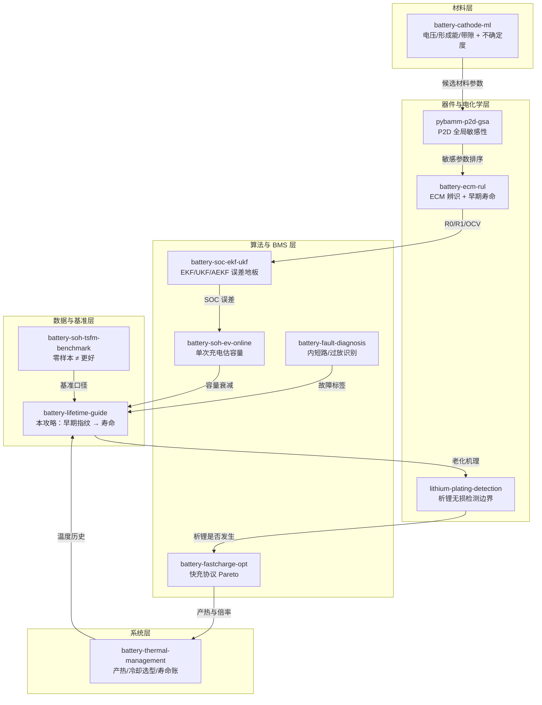

# 13 电池项目地图：十个仓库，一条从材料到系统的路线

> 这份文档回答一个问题：**读完（或读不动）本攻略之后，下一步该看哪个仓库。**
>
> 收录标准三条，缺一不进图：① 有一个**可核验数字**（能指到某个 CSV/JSON/测试）；
> ② 有一份**负结果清单**（写清楚什么没成立）；③ 与本攻略有**明确接口**（读前需要本文哪一节，
> 读后能回答本文哪个未决问题）。只有"我也做了电池"的不收。

## 13.1 一张图：五层 + 一条贯穿线

读图顺序不是从上到下，而是**从你手上的问题出发**：只想把寿命预测做扎实，走 `LIF → ECM → TSF`；
想做 BMS 工程，走 `SOC → SOH → FLT → FCO → THM`；想做材料，走 `CAT → P2D → PLT`。

## 13.2 十个仓库速查

数字一律按**原仓库自己的口径**引用，不跨仓库换算（原因见 §13.6）。

| 仓库 | 层 | 它回答的问题 | 一个可核验数字（原口径） | 建议 |
|---|---|---|---|---|
| [battery-cathode-ml](https://github.com/ilo-love7/battery-cathode-ml) | 材料 | 正极材料的电压/稳定性能不能预测，预测到哪一步就不能信 | 平均电压 MAE **0.352 V**（随机划分）/ **0.401 V**（按成分分组）；形成能 **0.0401 eV/5 原子胞**；结构覆盖率 40/40 | ★★ 材料向 |
| [pybamm-p2d-gsa](https://github.com/ilo-love7/pybamm-p2d-gsa) | 器件 | 一个电化学参数动了，到底哪个输出会变、变多少 | **21468 次** DFN 仿真（失败率 0.41%）；2C 温升由环境温度主导 `ST=0.96`，析锂指示由负极初始浓度主导 `ST=0.91` | ★★ 想做"物理约束"时 |
| [battery-ecm-rul](https://github.com/ilo-love7/battery-ecm-rul) | 器件 | 内阻/时间常数能不能从数据里"辨识"出来，还是只是拟合出了个数 | 同一份特征快照换定义：**6.18% → 8.33%**；内阻真值标尺 **38.6 mΩ**；τ₂ 判为不可辨识 | ★★★ 接着读 |
| [lithium-plating-detection](https://github.com/ilo-love7/lithium-plating-detection) | 器件 | 析锂到底能不能无损测出来，四种常见方法各能信到什么程度 | 合成 16 电芯四方法灵敏度/特异度均 **1.0**；真实 16 电芯 M1/M3/M4 全阴性，M2 峰移更可能是正常老化 | ★★★ 接着读 |
| [battery-soc-ekf-ukf](https://github.com/ilo-love7/battery-soc-ekf-ukf) | 算法 | SOC 估不准，是滤波器不行还是模型不行 | `hard` 场景 AEKF **1.21–2.91 pp** vs 库仑计数 **27–29 pp**；−20…25 °C 共 24 条工况 | ★★ BMS 向 |
| [battery-soh-ev-online](https://github.com/ilo-love7/battery-soh-ev-online) | 算法 | 一次日常充电能估出多少容量 | 38,744 段 / 191 车；XGBoost RMSE **0.826 Ah**（严格留一车 **0.812**），SOH **1.90 pp** | ★★ BMS 向 |
| [battery-fastcharge-opt](https://github.com/ilo-love7/battery-fastcharge-opt) | 算法 | 快充到底能多快，代价记在谁头上 | 充电时间律 `t=0.869·span/rate+0.432·span+0.173`（R²=0.978，MAPE 5.7%）；12 个无约束 Pareto 点中 **10 个**落在析锂区 | ★★ 工程向 |
| [battery-fault-diagnosis](https://github.com/ilo-love7/battery-fault-diagnosis) | 算法 | 电压/温度时序里，内短路和过放能不能分开 | 主库 dcnn64 三段 **Acc/wF1 1.000**；跨库段级 **0.884**；步级误报 **0.47%** | ★ 诊断向 |
| [battery-thermal-management](https://github.com/ilo-love7/battery-thermal-management) | 系统 | 产热多大、怎么冷、冷不下来会怎样 | 1C 自然对流 **+19.3 K 贴线**、3C 液冷 **+8.5 K**；3C 液冷寿命 **4.6×**；5C+45 °C+散热退化 30% → 芯温 105 °C，只剩 **620–640 s** | ★★ 系统向 |
| [battery-soh-tsfm-benchmark](https://github.com/ilo-love7/battery-soh-tsfm-benchmark) | 基准 | 时序基础模型的零样本，真的比线性外推强吗 | MIT **3.02 vs 4.07**（−26%）；CALCE 线性反赢 **1.76–2.39×**；胜负由 `knee_ratio`（8.88 vs 1.65）决定 | ★★★ 接着读 |

> 表中每个数字都能在原仓库的 `results/` 或报告中指到具体文件；本表**不替它们做汇总或平均**。

## 13.3 三个"接着读"：同一问题域的三次换角度

### 13.3.1 `battery-ecm-rul` — 同一篇论文的另一份实现，争的是"六特征怎么算"

本攻略与它是同一批数据（NASA PCoE + MIT-Stanford）、同一篇 Severson 2019、同一套官方划分的
**两份独立实现**。分工与口径对照在 [RELATED.md](../RELATED.md)，这里只补一句读法：

- 先读本攻略 `docs/03`（33.6% → 5.9% 的归因链），再读它的 `phase_c_rul.py` 与审计报告；
- 重点不是"谁更低"，而是**同一条管线换特征定义就能让中位误差从 6.18% 跳到 8.33%** ——
  这正是本攻略 §2.7「点估计接近 ≠ 统计一致」的另一种表现；
- 它独有的东西：ECM 参数辨识、PyBaMM DFN/SPM、内阻真值标尺（38.6 mΩ）、第三方辨识审计。
  这些是本攻略完全没有的能力，不是重复劳动。

### 13.3.2 `lithium-plating-detection` — 把"标签可不可信"推到传感层

本攻略花了整章证明 **NASA 34 颗里只有 3 颗的寿命标签成立**（`docs/06`）。析锂仓库把同一个问题
推到更前面：**"析锂"这个事件本身，用无损手段能不能可靠判定？**

它的结论值得抄进任何电池论文的"局限性"一节：合成真值上四方法灵敏度/特异度都是 1.0，
一到真实 16 电芯就只剩 M4 证据等级高，M2 的峰移**更可能是正常老化**。
这与本攻略"合成数据上的完美指标不是证据"是同一条纪律，只是换了一个物理量。

### 13.3.3 `battery-soh-tsfm-benchmark` — 基准怎么才算公平

如果你的下一步是"上一个大模型"，先读它。14 条发现里最贵的三条：

1. 零样本不是普遍更好：Chronos-T5 只在 MIT（3.02 vs 4.07）领先，CALCE 上线性外推反赢 1.76–2.39×；
2. 胜负由**数据有没有拐点**决定（`knee_ratio` 8.88 vs 1.65），不是由模型决定；
3. 少样本微调会**翻转结论**：19 颗电池把 Bolt 从 4.11 拉到 2.66，但学到的是"敢外推"而不是
   "该多陡"，起点低于 80% 的电芯会被外推到 0。

这正是本攻略 §2.6「地板效应：模型选择 = 分布匹配」的定量版。

## 13.4 从寿命预测走向 BMS 全栈

| 仓库 | 读它之前 | 读完能回答本文的哪个未决问题 |
|---|---|---|
| `battery-soc-ekf-ukf` | 本攻略 §2.7（区间与点估计纪律） | 为什么"换个更好的滤波器"通常不解决问题：模型误差是地板（AEKF 1.21–2.91 pp vs 库仑计数 27–29 pp） |
| `battery-soh-ev-online` | §13.3.1 的 ECM 辨识 | 容量估计里哪一组特征真正提供绝对尺度：库仑计数块去掉 +20%，形状块去掉只 +0.3% |
| `battery-fastcharge-opt` | 本攻略 §2.8（协议非平稳性） | 快充的"物理地板"在哪：CV 段 `0.43·span+0.17 h` 与倍率无关，1C→8C 只省 48% |
| `battery-thermal-management` | `fastcharge` 的产热账 | 表面温度为什么不够：芯-壳温差 3–16 K，表面 56 °C 时芯部已 91 °C |
| `battery-fault-diagnosis` | 本攻略 `docs/06` 数据审计 | 跨库还能剩多少：主库 1.000 → 跨库段级 0.884，掉分是常态不是事故 |
| `pybamm-p2d-gsa` | 本攻略 §2.2（磨耗型/拐点型） | 哪些参数值得测：17 个参数 ST<5% 进白名单，测它们等于浪费实验窗口 |
| `battery-cathode-ml` | 本攻略 §2.5（特征决定上限） | 材料侧的上限在哪：纯成分模型形成能 MAE 0.735 eV/atom，引入结构描述符降到 0.193，换 CGCNN 到 0.0401 |

## 13.5 三条入口路线（不用全读）

| 你的目标 | 读这三个 | 可以跳过 |
|---|---|---|
| 把"早期预测"做扎实（研究/毕设） | 本攻略 → `battery-ecm-rul` → `battery-soh-tsfm-benchmark` | 材料层、系统层 |
| 做 BMS 工程（求职/实习） | `battery-soc-ekf-ukf` → `battery-soh-ev-online` → `battery-thermal-management` | 材料层、P2D |
| 做材料/电化学（读研方向） | `battery-cathode-ml` → `pybamm-p2d-gsa` → `lithium-plating-detection` | BMS 三件、故障诊断 |

## 13.6 跨仓库的三条纪律（每条都有反例）

**（1）口径先于模型。** 同一份数据、同一个模型，换特征定义就能让中位误差从 6.18% 跳到 8.33%
（`battery-ecm-rul`）；同一批电池，把 `cycle_number` 当特征直接建模会得到"越用越健康"的假象
（`battery-fastcharge-opt` 的 metric trap）。**先冻结口径，再谈模型好坏。**

**（2）负结果是一等公民。** 本攻略有 17 个编号现场；`battery-ecm-rul` 判 τ₂ 不可辨识；
`lithium-plating-detection` 判 M2 峰移非析锂特异；`battery-soh-tsfm-benchmark` 判三种在线
`w` 估计路线全关死；`battery-thermal-management` 明写 Ea 敏感性三档。
一个仓库如果没有负结果清单，它的正结果也不值得信。

**（3）数字不可跨仓库拼。** 下表三列数字都叫"误差"，但**不可比**：

| 数字 | 出处 | 它的口径 |
|---|---|---|
| SOH 误差 **1.90 pp** | `battery-soh-ev-online` | 留一车，目标=绝对容量 Ah，38,744 段日常充电 |
| 平均电压 MAE **0.352 V** | `battery-cathode-ml` | 随机划分，MP 两相结构，材料级 |
| 中位误差 **5.9%** | 本攻略 | 官方 `test_ind` 43 颗，六特征弹性网，log 空间 |

把它们放进同一张"性能对比表"是**口径犯罪**：样本、划分、标签、单位全不同。
跨仓库只能对照**方法**与**结论方向**，不能对照数值大小。

## 13.7 维护规则

- 新增一个仓库进图，必须同时改三处：本文 §13.2 表、`README.md` / `README.zh-CN.md` 的
  「关联仓库」表、`tests/test_project_map.py` 的期望清单（测试会在任一处漏改时失败）。
- 每个仓库的"一个可核验数字"必须能在其仓库内指到文件；指不到就降级为"选读"或移出。
- 本图**不承诺**所有仓库都在同一版本线上，也不承诺数字之间可换算。
